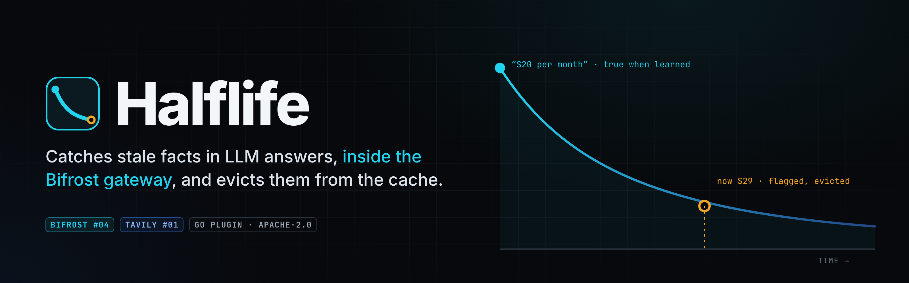
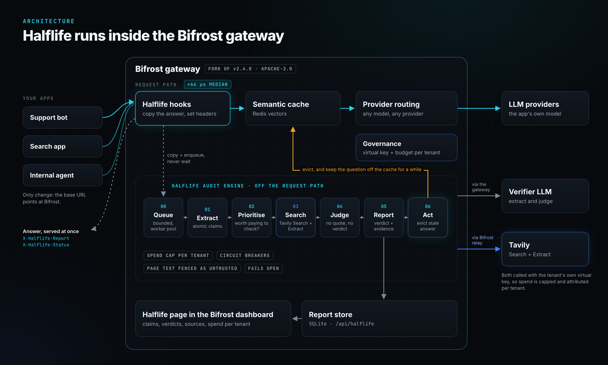
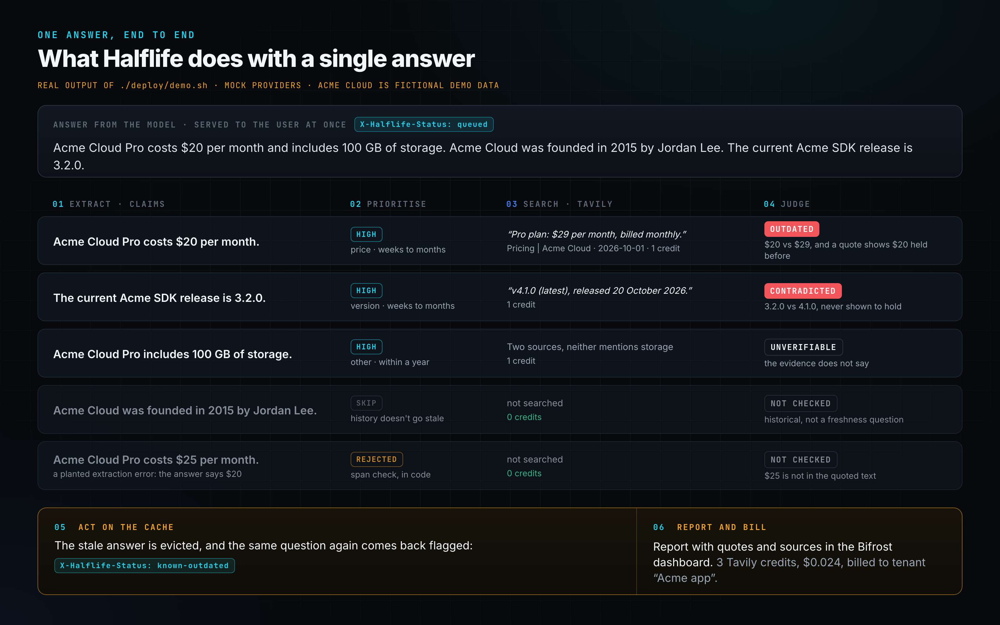
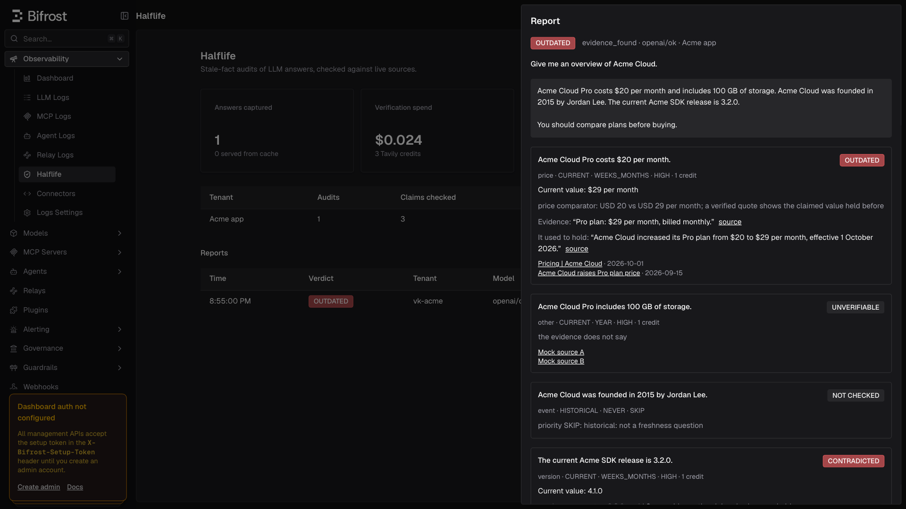
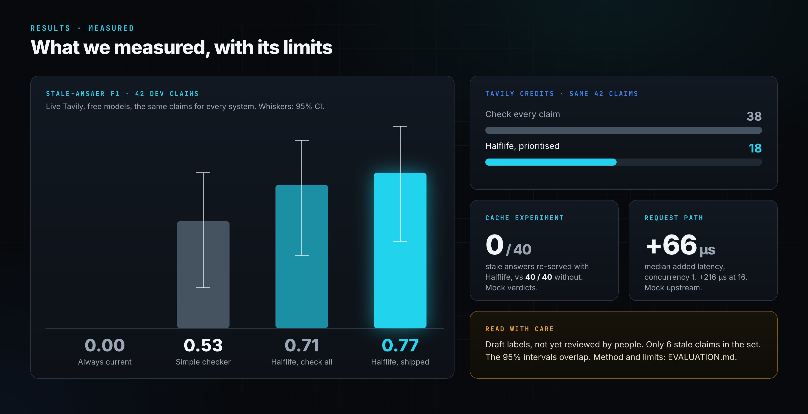

<p align="center"></p>

<p align="center">
  <b>Bifrost #04</b>: a feature the open-source gateway is missing &nbsp;·&nbsp; <b>Tavily #01</b>: a stale-answer detector<br>
  One project that answers both tracks. Built for the Geek Room Global AI Hackathon 2026.
</p>

<p align="center">
  <a href="#try-it-in-one-command">Try it</a> ·
  <a href="ARCHITECTURE.md">Architecture</a> ·
  <a href="EVALUATION.md">Evaluation</a> ·
  <a href="VALIDATION.md">Evidence log</a> ·
  <a href="https://github.com/priyansh-narang2308/halflife-bifrost/tree/halflife/plugins/halflife">Plugin source</a>
</p>

## The problem

Ask an assistant what a plan costs. It says *"$20 a month"*, instantly and confidently. The price changed to $29 last week. The model learned the old price, and nothing on the way to the user checks it.

A **semantic cache** makes this worse. Once a stale answer is cached, it is served again to everyone who asks something similar. In our cache experiment, with no check in place, **40 of 40** repeat requests for an outdated answer came straight from the cache.

## What Halflife does

Halflife is a **plugin inside the [Bifrost](https://github.com/maximhq/bifrost) AI gateway**, not a separate fact-checking service. Every answer from every app already passes through the gateway, so apps change only their base URL.

<p align="center"></p>

- **It never slows the answer down.** The hooks copy the answer and queue it, adding a median of **+66 µs**. The user gets the answer at once.
- **It only pays to check what can go stale.** Prices and versions get searched. A founding date doesn't, so it costs nothing.
- **Every verdict needs a quote.** The judge must quote its source word for word, and code, not the model, checks that the quote exists and holds the value. No quote, no verdict.
- **It fixes the cache.** Stale answers are evicted, and the question is kept off the cache for a while. The next response is flagged `known-outdated`.
- **Every tenant pays for its own checks.** Each search and judge call uses the tenant's own Bifrost virtual key and budget. When one tenant runs out, only its own checks pause.

## One answer, end to end

This is the real output of the demo script, with mock providers so anyone can repeat it.

<p align="center"></p>

Every report shows up on a **Halflife page inside Bifrost's own dashboard**, with claims, verdicts, quotes, sources, and spend per tenant:

<p align="center"></p>

## Results

<p align="center"></p>

On 42 dev claims checked with live Tavily and free models, Halflife scored a **stale-answer F1 of 0.77**, against **0.33** for a simple search-and-judge checker. It used **18 Tavily credits instead of 38**. These figures rest on draft labels and a small sample, and the confidence intervals still overlap slightly. [EVALUATION.md](EVALUATION.md) has the method and every limit. Read it before quoting a number.

## Why inside the gateway

| Bifrost gives Halflife | Tavily gives Halflife |
| --- | --- |
| Every answer, from every app, with no client change | Search built for agents, with dates and scores for recency |
| The semantic cache: the place stale answers get repeated from | Extract, to read the best source when a snippet falls short |
| Virtual keys, budgets and relays, so each tenant's checks are capped and attributed | Credit usage in every reply, reconciled against what Bifrost charged |

A standalone fact-checker only sees what each app remembers to send it. It can't clean the cache, and it can't say whose budget a check should come from.

## Try it in one command

The demo stack needs only Docker. Its LLM and Tavily are mocks with scripted answers, and it makes no external calls.

```bash
docker compose --profile demo up --build
```

```bash
./deploy/demo.sh
```

Then open the dashboard at <http://localhost:8080/workspace/halflife>.

<details>
<summary>Run with real providers, or share the demo</summary>

Put `OPENROUTER_API_KEY` and `TAVILY_API_KEY` in `.env` (see `.env.example`). The live config uses free models. It has no semantic cache, because it has no embedding provider configured.

```bash
HALFLIFE_ENV_FILE=.env HALFLIFE_CONFIG=./deploy/live/config.json docker compose up --build
```

`./deploy/share.sh` starts the mock demo with a fresh setup token and opens an ngrok tunnel. It needs a free ngrok account and your machine running. The mock stack never receives your `.env`.

The keys and setup token in `deploy/` are synthetic and public. Never expose the live config with them.
</details>

## Built, tested, and what's left

| | |
| --- | --- |
| **Built** | The plugin: capture, claim extraction, prioritisation, Tavily retrieval, judging, reports, cache eviction. Three modes (`monitor`, `audit`, `protect`), per-tenant keys and spend caps, circuit breakers, and the dashboard page |
| **Tested** | Unit tests (`make test`, 96.1% plugin coverage). Suites run through a real gateway against mocks (`make smoke cache relay budget tenants verify failures …`). A latency benchmark (`make bench`). Every check, its output, and whether it ran live or on mocks are logged in [VALIDATION.md](VALIDATION.md) |
| **Not yet** | Human-reviewed labels and inter-rater agreement. The held-out test split, which runs once, after review. Streaming responses, which are not audited |

## How it works, in brief

| Step | What it does |
| --- | --- |
| **Capture** | Copies the answer, tenant, model and cache identity, and queues them. Never blocks |
| **Extract** | Splits the answer into atomic claims, each with a verbatim span, a category, and how fast it changes |
| **Prioritise** | Deterministic rules: is this claim worth paying to check? History and timeless facts are skipped |
| **Search** | Tavily Search through a Bifrost relay. One Extract on the best source when snippets fall short. Page text is fenced off as untrusted |
| **Judge** | CURRENT, OUTDATED, CONTRADICTED, CONFLICTING or UNVERIFIABLE. A quote must exist verbatim, and numbers are compared by code |
| **Act** | Evicts the stale cache entry and keeps the question off the cache for a TTL |

The full design is in [ARCHITECTURE.md](ARCHITECTURE.md).

## Repository

| Path | What's there |
| --- | --- |
| `bifrost/` | The fork, kept in its own repo: [halflife-bifrost](https://github.com/priyansh-narang2308/halflife-bifrost). `scripts/bootstrap-bifrost.sh` clones it here and checks it against upstream v2.4.0. The code: [plugin](https://github.com/priyansh-narang2308/halflife-bifrost/tree/halflife/plugins/halflife), [dashboard page](https://github.com/priyansh-narang2308/halflife-bifrost/tree/halflife/ui/app/workspace/halflife) |
| `eval/` | The HL-Claims dataset, the replay harness and the scorer |
| `testenv/` | Mock LLM, mock Tavily, the recording proxy and the suites |
| `deploy/`, `docker-compose.yml` | The demo and live stacks |
| `docs/` | The diagrams in this README, with their HTML sources (`docs/diagrams/render.sh`) |
| `ARCHITECTURE.md`, `EVALUATION.md`, `VALIDATION.md` | Design, numbers and limits, evidence |

## License

Bifrost is Apache-2.0. The fork keeps its license and notices ([LICENSE](https://github.com/priyansh-narang2308/halflife-bifrost/blob/halflife/LICENSE)), and Halflife's plugin code is in that fork under the same license.
